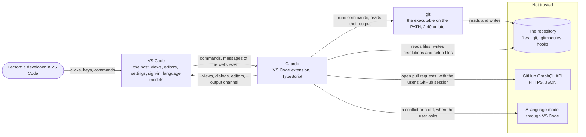
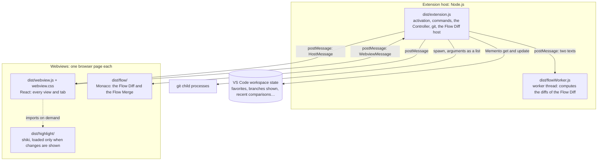

# Architecture

How Gitardo is built: the pieces that run, the folders of the source and which may use which, how a click becomes git
commands, and where to look for what. The [feature contract](04-feature-contract.md) says how a single feature is
shaped; this page is the frame around it.

## What "no dependencies at run time" means

The extension needs VS Code and the `git` executable on the `PATH`, nothing else at run time. What it uses from npm is
bundled by esbuild into `dist/` (React, the Codicons font, shiki for the colors of code, Monaco for the Flow Diff) and
listed in `package.json`; nothing is installed on the user's machine, and `npm run package` packs with
`--no-dependencies`. Git is run as a program, never through a library: what Gitardo does is what `git` does, and the
user can run the same commands (see [D24](../08-decisions.md#d24--run-the-git-executable-never-a-library)).

## Context

Who and what Gitardo talks to. The dashed box is what Gitardo does not control: the repository's contents, the replies
of GitHub and of the language model are input, never instructions (see [10-security.md](10-security.md)).



## Containers

The pieces that run apart. All of them are started by VS Code; none listens on a port.



| Container | Runs | Talks by |
| --- | --- | --- |
| Extension host | `dist/extension.js`, CommonJS for Node 20, started at `onStartupFinished` | VS Code's API |
| Flow Diff worker | `dist/flowWorker.js`, a `worker_threads` Worker of the host | messages (`src/flow/diff/protocol.ts`) |
| Webviews | `dist/webview.js` (classic script), one page per view or tab, picked by `data-view` | `postMessage`, typed in `src/shared/protocol.ts` |
| Flow pages | `dist/flow/main.js`, `dist/flow/merge.js` (ES modules, split in chunks) | `postMessage` (`src/flow/diff/protocol.ts`, `mergeProtocol.ts`) |
| git | a child process per command, `GIT_TERMINAL_PROMPT=0`, no shell | arguments, standard input, output |
| Gitardo's engine | `gitardo-engine --stdio`, one process per window, from `bin/<platform>-<arch>/` of the package or the development setting `gitardo.engine.path`; started the first time a repository is found, and started again after an exit as [transition/01-engine.md](../transition/01-engine.md#when-something-goes-wrong) says | JSON-RPC 2.0 on its standard input and output, framed with `Content-Length` ([transition/02-protocol.md](../transition/02-protocol.md)) |

## Modules

| Path | What is there |
| --- | --- |
| `src/git` | Git itself, with no VS Code in it: running it (`exec.ts`), finding the repositories of a folder (`discover.ts`), reading a repository (`repo.ts`), parsing what git prints (`parse.ts`), the commands of each operation (`ops.ts`), the conflicts that need no choice (`conflicts.ts`), what is proposed for each conflict (`review.ts`), what new worktrees get (`worktreeSetup.ts`), the lines of a range (`lines.ts`), GitHub URLs and the pull requests query (`github.ts`). |
| `src/engine` | Gitardo's engine, from stage 1 of [the transition](../transition/06-roadmap.md): finding the binary (`binary.ts`), the framing (`framing.ts`), requests, notifications and `$/cancel` (`connection.ts`), the messages (`messages.ts`), the settings sent under the desktop's names (`settings.ts`), the process, its restarts and the features it runs (`client.ts`), the target of a feature from what a menu names (`target.ts`), and the engine of a window, with VS Code's settings, output channel, and the input boxes, picks and dialogs its features ask with (`vscode.ts`). From stage 2, `Controller.runOnEngine` sends it **Create branch…** (`branch.create`), and runs the `GitOp` when the binary is missing; no view reads through it yet: the tests compare its state with `Repo.state`. |
| `src/shared` | What the extension and the webviews both use: the messages between them (`protocol.ts`), the lanes of the graph (`graph.ts`), the tree of files (`tree.ts`), how references are named (`refs.ts`) and messages shown (`message.ts`), the branches shown (`scope.ts`), the blame's format (`blameFormat.ts`), the prompts of the language model (`commitPrompt.ts`, `conflictPrompt.ts`), proposals (`resolution.ts`), submodules' status, file icons, JSON with comments. |
| `src/extension` | VS Code: activation and commands (`extension.ts`), the `Controller` that owns the state and every webview (`controller.ts`), what an action asks and which operation it becomes (`actions.ts`), blame of the line and of the file (`blame.ts`, `fileBlame.ts`), the content of the diffs (`content.ts`), what is running (`activity.ts`), the review of conflicts (`conflictReview.ts`), GitHub sign-in (`github.ts`), the language model (`ai.ts`), file icons, the worktree settings and Explorer commands. |
| `src/webview` | The React UI of every view and tab, in one bundle. `main.tsx` picks the component from the `data-view` the host writes on the page. `menus.ts` has every context menu and `act()`. |
| `src/webview/highlight` | The colors of the code in the changes of a commit or a comparison, with shiki: a bundle of its own, imported only when changes are shown. |
| `src/flow` | The Flow Diff and the Flow Merge: host side (`flowDiff.ts`, `merge.ts`, `panel.ts`), the worker that computes diffs (`worker.ts`, `diff/`), and their own webview under `src/flow/webview`. |
| `src/dev` | The preview server: the webviews in a browser, against a real repository, read-only. |
| `test` | Vitest tests; `test/flow` for the Flow Diff; `test/e2e` for the suite inside VS Code and the window driver; `test/perf` for large repositories. See [06-testing.md](06-testing.md). |

`esbuild.mjs` makes every bundle. Every new file the extension needs at run time must also be let into the package in
`.vscodeignore`.

### Who may use whom

```text
            extension ──────────┐
           ╱    │     ╲         │
         flow   │      ╲        │
         │  ╲   │       ╲       │
         │   git ──────▶ shared ◀──── webview ── ─ ─▶ flow/webview, flow/diff   (marked)
         │              ▲                  └ ─ ─ ─▶ git/parse                   (marked)
         └──────────────┘
  dev ──▶ git, shared, extension/fileIconTheme
```

- `src/git` uses only `src/shared` and Node. It never imports `vscode`, so that it runs in the tests and in the preview
  server. *Followed: no file of `src/git` imports `vscode`; no tool checks it.*
- `src/shared` uses nothing of the others, but for one type: `protocol.ts` imports `SyntaxTheme` from
  `src/flow/diff/protocol.ts`. *Marked: a type of the Flow Diff that both use; it belongs in `src/shared`.*
- `src/webview` uses `src/shared`. It also uses pure code of other folders, bundled into the page:
  `src/git/parse.ts` (`workingChanges`, in `ChangesApp.tsx`), `src/flow/diff/computeDiff.ts` (the side changes),
  `src/flow/webview/columns.ts` and `languages.ts`. *Marked: these work because the code is pure, but nothing keeps it
  so; see [RS3](13-risks.md).*
- `src/flow` uses `src/git`, `src/shared` and two modules of `src/extension` (`content.ts`, `answers.ts`).
- `src/engine` uses only Node, and `vscode` in `vscode.ts` alone, so that the tests drive the rest; it imports neither
  `src/git` nor `src/webview` (rule R1.5). *Followed; no tool checks it.*
- `src/extension` uses all of the above.

## From a click to git

1. The webview posts a `WebviewMessage` (`src/shared/protocol.ts`). An operation on the repository is
   `{ type: 'action', action }`, posted by `act()` in `src/webview/menus.ts`. A command of the Command Palette calls the
   `Controller` directly from `extension.ts`.
2. `Controller.onMessage` handles it. An action goes to `Controller.action`, which reads the top of the reflog, and
   hands the action to `resolveAction` in `src/extension/actions.ts`. That asks what it needs (names, choices,
   confirmations of its own) and returns a `GitOp`, built in `src/git/ops.ts`, or nothing when the user cancelled.
3. `Controller.run` runs the `GitOp`: it shows the exact commands first when `gitardo.commandPreview` asks for that or
   when the operation can lose work (`danger`, `confirm`), logs each command to the **Gitardo** output channel, runs
   them one after the other with `git()` of `src/git/exec.ts`, and stops at the first that fails. When git refuses in
   the way the operation's `fallback` is for, the fallback is asked and run instead.
4. The repository is read again and a `HostMessage` of type `state` goes to the views. Only the views that show the
   graph are sent its commits (`showsGraph`), and only the commits they do not have yet.
5. Back in `Controller.action`, what **Undo** needs is recorded when the reflog cannot take the operation back: a deleted
   branch, a dropped stash, conflicts resolved, a squash merge, a series of cherry-picks or of commits of a patch, a
   split of the last commit.

In an area moved to the engine (from stage 2 of [the transition](../transition/06-roadmap.md), **Create branch…**),
steps 2 and 3 are the engine's:

1. `Controller.action` hands the action to `Controller.runOnEngine`, with the feature's identifier and its `Target`
   (`targetOf` in `src/engine/target.ts`). With no engine running (no binary, or stopped for good), it returns false
   and the `GitOp` runs as above (D49).
2. `EngineClient.runFeature` sends `feature/run`. While it runs, the engine asks with `feature/ask` and
   `feature/confirm`, and `VscodeAsker` (`src/engine/vscode.ts`) answers with VS Code's input boxes, quick picks and
   dialogs; an input box checks its text with `question/validate` as it is typed.
3. The engine runs the plan and logs each step, which comes back as `log/line` and goes to the **Gitardo** output
   channel with `[engine]` before it. `feature/followUps` comes before the answer, and `runOnEngine` carries out the
   follow-ups that are the extension's: a message, the inputs of the format remembered in `worktreeInputs`, the new
   `HEAD` selected in the graph once the repository is read again.

**Undo** still reads the reflog in TypeScript until stage 3, so a plan of the engine that moves `HEAD` is taken back
as one of a `GitOp`.

Anything that changes the repository is a `GitOp` or a plan of the engine, also what Gitardo does itself rather than
git (`writes`, `prepare`, `finish`): that is how it gets the preview, the log and Undo. The Flow Diff runs its index writes through
`Controller.runIn` for the same reason. Reads go through `Repo` and never take locks (`GIT_OPTIONAL_LOCKS=0`).

## State

- **The state of the repository** is one `RepoState`, read by `Repo.state()` and kept by the `Controller`
  (`setState`). The webviews get it in `state` messages and change nothing of it themselves.
- **One repository at a time**: the `Controller` shows one repository of the workspace, chosen in the toolbar's list or
  remembered from the last time. A tab of a commit or a comparison stays with the repository it was opened for.
- **One operation at a time**: while `Controller.run` runs one (`running`), another is refused and nothing is read; the
  read that was under way is let finish and dropped.
- **Reads follow the files**: file system watchers on `.git` (its `HEAD`, `index`, `refs`, `logs/refs/stash`,
  `worktrees`, `modules`, …) and on the working tree schedule a read, once per burst of changes. A read that started
  before an operation ended is dropped and followed by another.
- **What is kept between runs** is in VS Code's workspace state and in each webview's own state: see
  [11-data.md](11-data.md). What **Undo** remembers beyond the reflog is kept only in memory, until something else
  happens or the window is reloaded.

## Adding to the UI

- A new message is a case in `HostMessage` or `WebviewMessage`, a case in `Controller.onMessage`, and, for the
  preview, a case in `handle` of `src/dev/server.ts`, which logs the messages it does not know.
- A new view kind is a `ViewKind`, an entry in `VIEWS` of `src/webview/main.tsx`, and its registration in
  `extension.ts` or its tab in the controller.
- The webviews use VS Code's CSS variables and the Codicons (`<Icon name="…" />`); `src/webview/styles.css` is the one
  stylesheet. Check a change in a dark and a light theme.
- The pages of a commit and of a comparison share `FileChanges`: a change there is a change to both.
- State that a view should keep while it is hidden goes through `loadUiState` and `saveUiState` in
  `src/webview/vscode.ts`. Never return what `setState` of VS Code returns from an effect: it crashes the page.

## Long work and what is running

The reads of the repository and the operations show in the status bar while they run, through the `Activity` of the
controller (`src/extension/activity.ts`). Anything else the user may wait for, such as a comparison or a request to
GitHub, goes through `activity.track` too, so that the status bar and **Gitardo: Show What Is Running** say what it
is. Nothing a user starts can be cancelled once its commands run; a question can always be cancelled before.

## Where things are

| You want to change | Look in |
| --- | --- |
| The commands an operation runs | `src/git/ops.ts` |
| What an operation asks, and when it refuses | `src/extension/actions.ts`, `resolveAction` |
| When a menu entry is offered | `src/webview/menus.ts` |
| What Undo does | `undoOp` and the `restore…Op` builders in `src/git/ops.ts`, the `undo` case of `resolveAction`, and the end of `Controller.action` |
| The question before an operation, and the log | `Controller.run` and `Controller.describe` in `src/extension/controller.ts` |
| What is read from git, and how it is parsed | `src/git/repo.ts`, `src/git/parse.ts` |
| The lanes of the graph | `src/shared/graph.ts` |
| The rules for conflicts | `src/git/conflicts.ts`, `src/git/review.ts` |
| A command of the Command Palette, a setting | `package.json` (`contributes`) and `src/extension/extension.ts` |
| The look of a view | the component in `src/webview`, and `src/webview/styles.css` |
| Which repository is shown, and VS Code's Repositories view | `Controller.selectRepo` in `src/extension/controller.ts`, `src/extension/sourceControlSelection.ts` |
