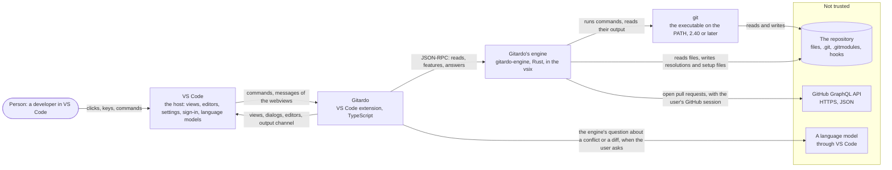
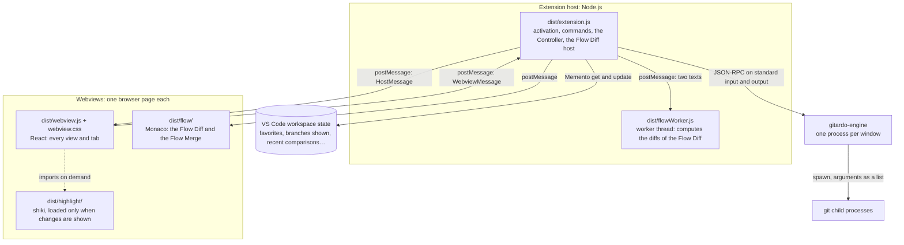

# Architecture

How Gitardo is built: the pieces that run, the folders of the source and which may use which, how a click becomes git
commands, and where to look for what. The [feature contract](04-feature-contract.md) says how a single feature is
shaped; this page is the frame around it.

## What "no dependencies at run time" means

The extension needs VS Code, the `git` executable on the `PATH`, and Gitardo's engine, `gitardo-engine`, which its vsix
holds for its system (one vsix per target), nothing else at run time. What it uses from npm is bundled by esbuild into
`dist/` (React, the Codicons font, shiki for the colors of code, Monaco for the Flow Diff) and listed in
`package.json`; nothing is installed on the user's machine, and `npm run package` packs with `--no-dependencies`. The
extension runs no git itself: the engine does, as a program, never through a library, so that what Gitardo does is
what `git` does, and the user can run the same commands
(see [D24](../08-decisions.md#d24--run-the-git-executable-never-a-library)). Without the engine for its system, the
extension says so and does nothing else ([D49](../08-decisions.md#d49--when-the-engines-binary-is-missing-proposed)).

## Context

Who and what Gitardo talks to. The dashed box is what Gitardo does not control: the repository's contents, the replies
of GitHub and of the language model are input, never instructions (see [10-security.md](10-security.md)).



## Containers

The pieces that run apart. All of them are started by VS Code; none listens on a port.



| Container | Runs | Talks by |
| --- | --- | --- |
| Extension host | `dist/extension.js`, CommonJS for Node 20, started at `onStartupFinished` | VS Code's API |
| Flow Diff worker | `dist/flowWorker.js`, a `worker_threads` Worker of the host | messages (`src/flow/diff/protocol.ts`) |
| Webviews | `dist/webview.js` (classic script), one page per view or tab, picked by `data-view` | `postMessage`, typed in `src/shared/protocol.ts` |
| Flow pages | `dist/flow/main.js`, `dist/flow/merge.js` (ES modules, split in chunks) | `postMessage` (`src/flow/diff/protocol.ts`, `mergeProtocol.ts`) |
| git | a child process of the engine per command, `GIT_TERMINAL_PROMPT=0`, no shell | arguments, standard input, output |
| Gitardo's engine | `gitardo-engine --stdio`, one process per window, from `bin/<platform>-<arch>/` of the package or the development setting `gitardo.engine.path`; started the first time a repository is found, and started again after an exit as [transition/01-engine.md](../transition/01-engine.md#when-something-goes-wrong) says | JSON-RPC 2.0 on its standard input and output, framed with `Content-Length` ([transition/02-protocol.md](../transition/02-protocol.md)) |

## Modules

| Path | What is there |
| --- | --- |
| `src/engine` | Gitardo's engine, which reads and changes the repository for the extension: finding the binary (`binary.ts`), the framing (`framing.ts`), requests, notifications and `$/cancel` (`connection.ts`), the messages (`messages.ts`), the settings sent under the desktop's names (`settings.ts`), the process, its restarts and the features it runs (`client.ts`), the features an action of a view becomes (`actions.ts`, `engineRuns`) and their target (`target.ts`), every read a view makes (`reads.ts`, with the engine's answer in the view's shape by `shapes.ts`), the graph's rows (`graph.ts`), the files in conflict as the review works on them (`conflictPlans.ts`), the resolutions it writes (`resolutions.ts`), and the engine of a window, with VS Code's settings, output channel, and the input boxes, picks and dialogs its features ask with (`vscode.ts`). |
| `src/shared` | What the extension and the webviews both use, none of it running git: the messages between them (`protocol.ts`), the engine's state and details of a commit (`state.ts`), the lanes of the graph (`graph.ts`), the tree of files (`tree.ts`), how references are named (`refs.ts`) and messages shown (`message.ts`), the branches shown (`scope.ts`), the blame's format (`blameFormat.ts`), the conflicts that need no choice (`conflicts.ts`) and the review of the others (`review.ts`, `resolution.ts`, `proposalLines.ts`, `conflictPrompt.ts`), what new worktrees get (`worktreeSetup.ts`), the rows of the changes (`changes.ts`), paths (`paths.ts`), GitHub URLs (`github.ts`), submodules' status, file icons, JSON with comments. |
| `src/extension` | VS Code: activation and commands (`extension.ts`), the `Controller` that owns the state and every webview (`controller.ts`), what an action asks and which operation it becomes (`actions.ts`), blame of the line and of the file (`blame.ts`, `fileBlame.ts`), the content of the diffs (`content.ts`), what is running (`activity.ts`), the review of conflicts (`conflictReview.ts`), GitHub sign-in (`github.ts`), the language model (`ai.ts`), file icons, the worktree settings and Explorer commands. |
| `src/webview` | The React UI of every view and tab, in one bundle. `main.tsx` picks the component from the `data-view` the host writes on the page. `menus.ts` has every context menu and `act()`. |
| `src/webview/highlight` | The colors of the code in the changes of a commit or a comparison, with shiki: a bundle of its own, imported only when changes are shown. |
| `src/flow` | The Flow Diff and the Flow Merge: host side (`flowDiff.ts`, `merge.ts`, `panel.ts`), the worker that computes diffs (`worker.ts`, `diff/`), and their own webview under `src/flow/webview`. |
| `src/dev` | The preview server: the webviews in a browser, against a real repository, read-only. |
| `test` | Vitest tests; `test/flow` for the Flow Diff; `test/e2e` for the suite inside VS Code and the window driver; `test/perf` for large repositories. See [06-testing.md](06-testing.md). |

`esbuild.mjs` makes every bundle. Every new file the extension needs at run time must also be let into the package in
`.vscodeignore`.

### Who may use whom

```text
            extension ──────────┐
           ╱    │     ╲         │
         flow   │      ╲        │
         │  ╲   │       ╲       │
         │   engine ───▶ shared ◀──── webview ── ─ ─▶ flow/webview, flow/diff   (marked)
         │              ▲
         └──────────────┘
  dev ──▶ engine, shared, extension/fileIconTheme
```

- `src/shared` uses nothing of the others, but for one type: `protocol.ts` imports `SyntaxTheme` from
  `src/flow/diff/protocol.ts`. *Marked: a type of the Flow Diff that both use; it belongs in `src/shared`.*
- `src/webview` uses `src/shared`. It also uses pure code of other folders, bundled into the page:
  `src/flow/diff/computeDiff.ts` (the side changes), `src/flow/webview/columns.ts` and `languages.ts`. *Marked: these
  work because the code is pure, but nothing keeps it so; see [RS3](13-risks.md).*
- `src/flow` uses `src/engine`, `src/shared` and two modules of `src/extension` (`content.ts`, `answers.ts`): it reads
  through `src/engine/reads.ts` and runs the engine's features through the `Controller`.
- `src/engine` uses only Node and `src/shared`, and `vscode` in `vscode.ts` alone, so that the tests drive the rest; it
  never imports `src/webview` (rule R1.5). *Followed; no tool checks it.*
- No file of `src/` runs `git`, nor any other program but the engine (rule R1.4).
- `src/extension` uses all of the above.

## From a click to git

1. The webview posts a `WebviewMessage` (`src/shared/protocol.ts`). An operation on the repository is
   `{ type: 'action', action }`, posted by `act()` in `src/webview/menus.ts`. A command of the Command Palette calls the
   `Controller` directly from `extension.ts`.
2. `Controller.onMessage` handles it. An action goes to `Controller.action`. What is VS Code's alone, such as opening a
   worktree in a window, a terminal or the Explorer, is done there by `hostAction` (`src/extension/actions.ts`), and
   runs no git. Any other action becomes the features of the engine that run it, with their `Target`
   (`engineRuns` in `src/engine/actions.ts`, `targetOf` in `src/engine/target.ts`); an action that is none of them runs
   nothing. With no engine running (no binary, or stopped for good), the command says **Gitardo's engine is not
   available on this system.** with **Show the log** (`sayEngineMissing`, D49), and nothing runs.
3. `Controller.runOnEngine` runs them one at a time: `EngineClient.runFeature` sends `feature/run`. While it runs,
   the engine asks with `feature/ask` and `feature/confirm`, and `VscodeAsker` (`src/engine/vscode.ts`) answers with VS Code's input boxes, quick picks and
   dialogs; an input box checks its text with `question/validate` as it is typed. What only VS Code can add is given
   as `HostHooks`: choices of its own at the end of a pick, such as **Edit the list of identities…**, and what it does
   once a plan is confirmed and before its steps, such as having VS Code's Git close the worktrees **Clean up
   branches** removes.
4. The engine runs the plan and logs each step, which comes back as `log/line` and goes to the **Gitardo** output
   channel, `> ` before a command; a failure, a warning or a read has `[engine]` before it. `feature/followUps` comes
   before the answer, and `runOnEngine` carries out the follow-ups that are the extension's: a message, the inputs of
   the format remembered in `worktreeInputs`, the new `HEAD` selected in the graph once the repository is read again,
   the pull requests read again after a fetch, a pull or a push. An operation offered with the failure of a step, such
   as **Delete anyway**, is a button on the error, which sends `feature/run` with the feature, target and answers the
   engine gave (`offerRun`).
5. The repository is read again and a `HostMessage` of type `state` goes to the views. Only the views that show the
   graph are sent its commits (`showsGraph`), and only the commits they do not have yet.

**Undo** is the engine's too: `feature/run` of `undo.last`, which takes back the newest entry of the engine's journal,
where every feature the engine ran is. The tooltip of **Undo** names the newest entry, from `journal/last`
(`RepoState.undo`).

Anything that changes the repository is a plan of the engine, also what Gitardo does itself rather than git (the
writes of a resolution, of a rebase's todo list): that is how it gets the preview, the log and Undo. The Flow Diff
runs its stage, unstage and discard through `Controller.runIn`, which hands them to `runOnEngine` (`changes.stage`,
`diff.stage-change` with a `diffChange` target, …), and the Flow Merge its **Mark as resolved**
(`merge-view.mark-resolved`). The review of the conflicts writes what is accepted with `review.write`, its target built
by `src/engine/resolutions.ts`. Reads never take locks (`GIT_OPTIONAL_LOCKS=0`).

## Where the reads come from

Everything a view reads comes from the engine's reads of [the protocol](../transition/02-protocol.md#reads), in one
place, `src/engine/reads.ts`: the `reads` of the window, given the running engine at activation (`reads.use`), has a
method for each read a view makes, which asks the engine and, where the view's shape is not the engine's, turns its
answer into it (`src/engine/shapes.ts`). With no engine running, `reads.available` is false and `reads.client()`
throws `EngineMissing`: the views get a `state` message with `engineMissing` and say **Gitardo's engine is not
available on this system.** with **Show the log** (`Placeholder` of `src/webview/Placeholder.tsx`, D49). The folders
of the workspace are searched for repositories with `repository/discover` (`reads.discover`).

The state's parts (`RepoParts`: `HEAD`, branches, tags, stashes, worktrees, submodules, remotes, the working tree,
the operation and its stop, bisect, the identity, the last moves of `HEAD`) come from `repo.read-state`, read once
per burst of changes, and the files the rules resolve from `conflicts.resolve-by-rules`. The GitHub token is given to
the engine by `githubSession`, when it asks with `host/githubToken`. The review of the conflicts reads the text of each
file and its sides with `conflictPlans` (`src/engine/conflictPlans.ts`), and works out what needs no choice with
`resolveConflicts` of `src/shared/conflicts.ts`.

The rows of the graph, the position of a commit and the matches of a search are read by the engine
(`src/engine/graph.ts`): `graphState` puts the parts and the rows together and lays out the lines from their parents
(`src/shared/graph.ts`). `EngineGraph` keeps one read of the commits for each repository, asked with `stream` (version
1.8 of the protocol) so that its pages come as git prints them; each page is laid out under the rows before it from the
lanes under the last of them (`LaidOutRows`), the read is kept while the history is the same, and one that another takes
the place of is cancelled. Past 100,000 commits the next read is asked with `skip` from the last row read.

### The views' shapes

From stage 6 the state of a repository and the details of a commit are the engine's types, field for field:
`src/shared/state.ts` writes them as `repo.read-state` and `details.read-commit` answer (`RepositoryState`,
`CommitDetail` and what they are made of: `Head`, `Branch`, `Worktree`, `WorkingTree`, `FileChange`, `Submodule`, …),
and the extension, the webviews and the preview server read those fields. What the views show that the engine does not
write is worked out from those fields where it is shown, with the helpers beside the types:

- the branch checked out by its short name, `checkedOutBranch`, from `head.branch`, which is the full name
  (`refs/heads/main`), and that of a worktree, `worktreeBranch`;
- the branches checked out last, `recentBranches` of `src/shared/refs.ts`, from `reflogSubjects`;
- the upstream as git names it short, `upstreamName`, from `upstream.reference`;
- the letter of a file's change, `CHANGE_LETTERS`, from its `kind`; a file not tracked or in conflict is marked `?` or
  `U` from the working tree (`workingMarks` of `src/webview/FileRow.tsx`), since the details list it as added or
  modified;
- the subject and the body of a commit, `subjectAndBody` of `src/shared/message.ts`, from its `message`;
- the uncommitted changes shown as a commit, `uncommittedDetail`, from the working tree, in its order: the conflicts,
  the index, the working tree, the untracked files;
- the git name of an operation, `operationName` (`cherry-pick`, `am`), from the engine's (`cherryPick`, `patch`).

The count of what is not committed in each worktree is the engine's `uncommitted`, and a commit that is not there yet,
before the first commit, is `null`, not an id of zeros. What the extension adds is beside the engine's fields, in
`RepoState` of `src/shared/protocol.ts`: the folder `root` and `name`, the rows of the graph and `hasMore`, `changes`,
`filter`, `scope`, the favorites, the settings sent with the state, the pull requests, the repositories of the
workspace and `undo`; and in `RepoParts`, `conflictFiles`, the engine's proposals for the conflicts in the review's
shape. The other reads keep their own shapes and are converted by `shapes.ts`. `test/engineShapes.ts` checks the types
against the JSON the engine writes ([06-testing.md](06-testing.md#the-engines-shapes)).

## State

- **The state of the repository** is one `RepoState`, the engine's `RepositoryState` with what the extension adds,
  kept by the `Controller` (`setState`). `Controller.readState` reads its parts with `reads.parts` (`repo.read-state`
  of the engine), then the commits of the graph with `graphState`. The webviews get it in `state` messages and change
  nothing of it themselves.
- **One repository at a time**: the `Controller` shows one repository of the workspace, chosen in the toolbar's list or
  remembered from the last time. A tab of a commit or a comparison stays with the repository it was opened for.
- **One operation at a time**: while `Controller.runOnEngine` runs one (`running`), another is refused and nothing is
  read; the read that was under way is let finish and dropped.
- **Reads follow the files**: file system watchers on `.git` (its `HEAD`, `index`, `refs`, `logs/refs/stash`,
  `worktrees`, `modules`, …) and on the working tree schedule a read, once per burst of changes. A read that started
  before an operation ended is dropped and followed by another.
- **What is kept between runs** is in VS Code's workspace state and in each webview's own state: see
  [11-data.md](11-data.md). What **Undo** remembers beyond the reflog is the engine's journal, kept in its memory, until
  the window is reloaded.

## Adding to the UI

- A new message is a case in `HostMessage` or `WebviewMessage`, a case in `Controller.onMessage`, and, for the
  preview, a case in `handle` of `src/dev/server.ts`, which logs the messages it does not know.
- A new view kind is a `ViewKind`, an entry in `VIEWS` of `src/webview/main.tsx`, and its registration in
  `extension.ts` or its tab in the controller.
- The webviews use VS Code's CSS variables and the Codicons (`<Icon name="…" />`); `src/webview/styles.css` is the one
  stylesheet. Check a change in a dark and a light theme.
- The pages of a commit and of a comparison share `FileChanges`: a change there is a change to both.
- State that a view should keep while it is hidden goes through `loadUiState` and `saveUiState` in
  `src/webview/vscode.ts`. Never return what `setState` of VS Code returns from an effect: it crashes the page.

## Long work and what is running

The reads of the repository and the operations show in the status bar while they run, through the `Activity` of the
controller (`src/extension/activity.ts`). Anything else the user may wait for, such as a comparison or a request to
GitHub, goes through `activity.track` too, so that the status bar and **Gitardo: Show What Is Running** say what it
is. Nothing a user starts can be cancelled once its commands run; a question can always be cancelled before.

## Where things are

| You want to change | Look in |
| --- | --- |
| The commands an operation runs, what it asks, when it refuses, what Undo does | the engine, in `../rust` (its card in `docs/features/`), desktop first |
| Which feature of the engine an action of a view runs | `engineRuns` in `src/engine/actions.ts`, `src/engine/target.ts` |
| What an action does in VS Code alone | `hostAction` in `src/extension/actions.ts` |
| When a menu entry is offered | `src/webview/menus.ts` |
| The questions of the engine in VS Code, and the log | `VscodeAsker` in `src/engine/vscode.ts`, `Controller.runOnEngine` in `src/extension/controller.ts` |
| What a view reads, and the engine's answer in the view's shape | `src/engine/reads.ts`, `src/engine/shapes.ts` |
| The engine's state and details of a commit, as the views read them, and what is worked out from them | `src/shared/state.ts` |
| The lanes of the graph | `src/shared/graph.ts` |
| The rules for conflicts, and the review | `src/shared/conflicts.ts`, `src/shared/review.ts`, `src/engine/conflictPlans.ts` |
| A command of the Command Palette, a setting | `package.json` (`contributes`) and `src/extension/extension.ts` |
| The look of a view | the component in `src/webview`, and `src/webview/styles.css` |
| Which repository is shown, and VS Code's Repositories view | `Controller.selectRepo` in `src/extension/controller.ts`, `src/extension/sourceControlSelection.ts` |
